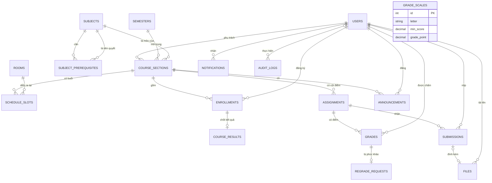

# 05 — Mô hình dữ liệu (to-be)

> Phiên bản 0.1 · 2026-11-09 · MySQL 8 (InnoDB, utf8mb4) · Rule: 03-BUSINESS-RULES · Sơ đồ chính thức: ERD-01 và REL-01 trong draw.io (07-DIAGRAMS)

## 1. Tổng quan ERD

Sơ đồ dưới đây để xem nhanh trên GitHub. Bản chính thức (có đủ thuộc tính, ký hiệu crow's foot) vẽ bằng draw.io.



Có 18 bảng: 1 bảng người dùng, 6 bảng học vụ (semesters, subjects, subject_prerequisites, rooms, course_sections, schedule_slots), 2 bảng đăng ký/kết quả (enrollments, course_results), 6 bảng học tập (assignments, submissions, files, grades, regrade_requests, announcements), 1 bảng cấu hình (grade_scales), 2 bảng hệ thống (notifications, audit_logs).

## 2. Lược đồ quan hệ

Ký hiệu: `PK` khóa chính · `FK→bảng` khóa ngoại · `UQ` duy nhất · `NN` bắt buộc · `NULL` cho phép rỗng. Mọi bảng có `created_at` (UTC); bảng có sửa thì có thêm `updated_at`. Khóa chính là `BIGINT` tự tăng, trừ khi ghi khác.

```
users(id PK, email VARCHAR(255) UQ NN, full_name VARCHAR(255) NN,
      role ENUM('ADMIN','INSTRUCTOR','STUDENT') NN, student_code VARCHAR(20) UQ NULL,
      password_hash VARCHAR(255) NN, must_change_password BOOL NN DEFAULT TRUE,
      is_active BOOL NN DEFAULT TRUE, last_login_at DATETIME NULL, created_at, updated_at)

semesters(id PK, code VARCHAR(20) UQ NN, name VARCHAR(100) NN,
      start_date DATE NN, end_date DATE NN,
      registration_start_at DATETIME NN, registration_end_at DATETIME NN,
      min_credits SMALLINT NN, max_credits SMALLINT NN, created_at, updated_at)
      CHECK(start_date < end_date) CHECK(registration_start_at < registration_end_at)
      CHECK(min_credits <= max_credits)

subjects(id PK, code VARCHAR(20) UQ NN, name VARCHAR(255) NN,
      credits SMALLINT NN CHECK(credits BETWEEN 1 AND 10),
      is_graded BOOL NN DEFAULT TRUE, description TEXT NULL, created_at, updated_at)

subject_prerequisites(subject_id FK→subjects, prerequisite_id FK→subjects,
      PK(subject_id, prerequisite_id), CHECK(subject_id <> prerequisite_id))

rooms(id PK, code VARCHAR(20) UQ NN, name VARCHAR(100) NN,
      capacity SMALLINT NN CHECK(capacity > 0), created_at, updated_at)

course_sections(id PK, semester_id FK→semesters NN, subject_id FK→subjects NN,
      section_code VARCHAR(20) NN, instructor_id FK→users NN,
      capacity SMALLINT NN CHECK(capacity > 0),
      status ENUM('DRAFT','PUBLISHED','LOCKED') NN DEFAULT 'DRAFT',
      locked_at DATETIME NULL, locked_by FK→users NULL, created_at, updated_at,
      UQ(semester_id, section_code))

schedule_slots(id PK, section_id FK→course_sections NN ON DELETE CASCADE, room_id FK→rooms NN,
      day_of_week TINYINT NN CHECK(day_of_week BETWEEN 1 AND 7),
      start_time TIME NN, end_time TIME NN, CHECK(start_time < end_time))

enrollments(id PK, section_id FK→course_sections NN, student_id FK→users NN,
      status ENUM('ENROLLED','DROPPED') NN, source ENUM('SELF','ADMIN') NN,
      override_reason TEXT NULL, enrolled_at DATETIME NN, dropped_at DATETIME NULL,
      UQ(section_id, student_id))

course_results(enrollment_id PK FK→enrollments, final_score_10 DECIMAL(9,6) NN,
      letter_grade VARCHAR(2) NULL, grade_point DECIMAL(3,2) NULL,
      is_passed BOOL NN, finalized_at DATETIME NN)
      -- letter_grade và grade_point là NULL với môn Non-Graded

grade_scales(id PK, letter VARCHAR(2) UQ NN, min_score DECIMAL(4,2) UQ NN,
      grade_point DECIMAL(3,2) NN, is_passing BOOL NN)

assignments(id PK, section_id FK→course_sections NN, title VARCHAR(255) NN, description TEXT NULL,
      weight_percent DECIMAL(5,2) NN CHECK(weight_percent > 0 AND weight_percent <= 100),
      submission_mode ENUM('SINGLE','OVERWRITE','MULTIPLE','OFFLINE') NN,
      max_attempts SMALLINT NULL CHECK(max_attempts >= 1),
      due_at DATETIME NULL, late_policy ENUM('REJECT','ACCEPT_MARK_LATE') NULL,
      grade_visibility ENUM('IMMEDIATE','MANUAL') NN DEFAULT 'IMMEDIATE',
      grades_published_at DATETIME NULL, created_by FK→users NN, created_at, updated_at)
      CHECK((submission_mode = 'OFFLINE' AND due_at IS NULL AND late_policy IS NULL)
         OR (submission_mode <> 'OFFLINE' AND due_at IS NOT NULL AND late_policy IS NOT NULL))
      CHECK((submission_mode = 'MULTIPLE') = (max_attempts IS NOT NULL))

files(id PK, uploaded_by FK→users NN, original_name VARCHAR(255) NN,
      stored_path VARCHAR(500) UQ NN, mime_type VARCHAR(100) NN, size_bytes INT NN, created_at)

submissions(id PK, assignment_id FK→assignments NN, student_id FK→users NN,
      attempt_no SMALLINT NN DEFAULT 1, content_url VARCHAR(2048) NULL, file_id FK→files UQ NULL,
      is_late BOOL NN, submitted_at DATETIME NN,
      UQ(assignment_id, student_id, attempt_no),
      CHECK(content_url IS NOT NULL OR file_id IS NOT NULL))

grades(id PK, assignment_id FK→assignments NN, student_id FK→users NN,
      score DECIMAL(4,2) NN CHECK(score BETWEEN 0 AND 10), feedback TEXT NULL,
      graded_by FK→users NN, graded_at DATETIME NN, updated_at DATETIME NN,
      visible_at DATETIME NULL, UQ(assignment_id, student_id))

regrade_requests(id PK, grade_id FK→grades UQ NN, reason TEXT NN,
      status ENUM('PENDING','ACCEPTED','REJECTED') NN DEFAULT 'PENDING',
      old_score DECIMAL(4,2) NN, new_score DECIMAL(4,2) NULL, response TEXT NULL,
      resolved_by FK→users NULL, created_at, resolved_at DATETIME NULL)

announcements(id PK, section_id FK→course_sections NN, author_id FK→users NN,
      title VARCHAR(255) NN, content TEXT NN, created_at, updated_at)

notifications(id PK, user_id FK→users NN, type VARCHAR(50) NN, params JSON NN,
      link VARCHAR(255) NULL, is_read BOOL NN DEFAULT FALSE, created_at)

audit_logs(id PK, actor_id FK→users NULL, action VARCHAR(50) NN,
      entity_type VARCHAR(50) NN, entity_id BIGINT NN,
      before_data JSON NULL, after_data JSON NULL, reason TEXT NULL, created_at)
```

## 3. Ràng buộc, chỉ mục và kiểu liệt kê

**Ràng buộc DB thể hiện BR** (mỗi dòng có test ở 08):

| Ràng buộc | BR |
|---|---|
| `users.email` UQ, lưu chữ thường | BR-ACC-02 |
| `users.student_code` UQ | BR-ACC-08 |
| `enrollments` UQ(section_id, student_id) | BR-ENR-09 |
| `submissions` UQ(assignment_id, student_id, attempt_no) | BR-SUB-08 |
| `grades` UQ(assignment_id, student_id) | BR-GRD-02 |
| `regrade_requests.grade_id` UQ | BR-REG-02 |
| CHECK của `assignments` (OFFLINE, MULTIPLE) | BR-ASG-04, 05 |
| CHECK `grades.score` 0–10 | BR-GRD-01 |
| CHECK `schedule_slots` (thứ 1–7, giờ bắt đầu < kết thúc) | BR-ACD-05 |

Ràng buộc liên quan nhiều dòng (tổng trọng số ≤ 100%, trùng lịch, sĩ số, tiên quyết, vòng lặp tiên quyết) **không** biểu diễn được bằng CHECK nên thực thi ở service, trong transaction.

**Chỉ mục** (ngoài PK, UQ và chỉ mục FK mà InnoDB tự tạo):
- `enrollments(student_id, status)`: lớp SV đang học (trùng lịch, giới hạn tín chỉ, bảng điểm).
- `course_sections(semester_id, instructor_id)`: kiểm tra trùng giờ GV, lịch dạy.
- `schedule_slots(room_id, day_of_week)`: kiểm tra trùng phòng.
- `grades(student_id)`: điểm của SV.
- `notifications(user_id, is_read, created_at)`: chuông thông báo.
- `audit_logs(entity_type, entity_id)` và `audit_logs(created_at)`: tra cứu nhật ký.

**Kiểu liệt kê:** `role`, `section.status`, `enrollment.status`, `enrollment.source`, `submission_mode`, `late_policy`, `grade_visibility`, `regrade.status`. Python và TypeScript dùng đúng các giá trị chuỗi này.

## 4. Dữ liệu tính khi đọc và dữ liệu chốt cố định

| Dữ liệu | Lưu hay tính | Lý do |
|---|---|---|
| Điểm tạm tính, % trọng số đã có điểm | Tính khi đọc | Thay đổi liên tục theo việc chấm |
| Trạng thái hiển thị của bài (Chưa nộp / Đã nộp / Nộp trễ / Đã chấm / Không cần nộp) | Tính từ `submissions`, `grades`, `assignments` | Tránh lệch như ISS-04 |
| Số chỗ còn lại của lớp | Tính: `capacity` − số ENROLLED | Luôn đúng |
| Kết quả môn (điểm gốc, chữ, hệ 4, đạt) | **Lưu** ở `course_results` lúc khóa sổ | BR-LCK-04: kết quả đã chốt không đổi khi đổi bảng quy đổi |
| GPA, TBC, tín chỉ tích lũy (theo kỳ và tích lũy) | Tính từ `course_results` + `subjects` | Một nguồn duy nhất, không bao giờ lệch |

## 5. Ma trận phân quyền (thay cho RLS)

MySQL không có Row-Level Security như PostgreSQL, nên quyền theo từng dòng dữ liệu được thực thi ở tầng service bằng các hàm trong `api/src/core/permissions.py` (`ensure_admin`, `ensure_section_instructor`, `ensure_enrolled`, `ensure_section_member`), cùng với việc truy vấn luôn lọc theo người dùng hiện tại. Mỗi ô trong bảng có test (08 §2).

Ký hiệu: **R** đọc · **W** tạo/sửa/xóa · "lớp mình" là lớp GV phụ trách hoặc lớp SV đang học.

| Tài nguyên | Admin | Giảng viên | Sinh viên |
|---|---|---|---|
| Người dùng | R/W tất cả | R bản thân | R bản thân |
| Học kỳ, môn học, phòng, bảng quy đổi | R/W | R | R |
| Lớp học phần | R/W (trừ khóa sổ) | R lớp mình; khóa sổ lớp mình | R lớp PUBLISHED đang mở đăng ký và lớp mình |
| Lịch học | R/W | R lớp mình | R lớp đang mở đăng ký và lớp mình |
| Đăng ký học | R/W tất cả; vượt ràng buộc kèm lý do | R danh sách lớp mình | W bản thân trong đợt; R của mình |
| Bài tập | R | R/W lớp mình (khi chưa khóa) | R lớp mình |
| Bài nộp, file | R | R lớp mình | R/W của mình |
| Điểm | R | R/W lớp mình (khi chưa khóa), công bố | R của mình, khi điểm đã hiện |
| Kết quả môn, bảng điểm | R | R lớp mình | R của mình |
| Phúc khảo | R | R và xử lý ở lớp mình | R/W của mình |
| Thông báo lớp | R | R/W lớp mình | R lớp mình |
| Thông báo hệ thống | R của mình | R của mình | R của mình |
| Nhật ký thao tác | R | — | — |
| Mở lại sổ | W | — | — |

Không có quyền cho khách (BR-GEN-03).

## 6. Dữ liệu seed cho demo

Seed chạy bằng `python scripts/seed.py`, chạy lặp lại được (đã có thì bỏ qua). Mốc thời gian **tính tương đối theo ngày chạy seed**, để demo hôm nào cũng đúng.

- **Tài khoản:** 1 Admin, 3 GV, 12 SV; email dạng `@campushub.edu.vn`. Mật khẩu demo dùng chung ghi trong README (G5). Các tài khoản demo không phải đổi mật khẩu, trừ một tài khoản `sv.moi@campushub.edu.vn` để demo luồng đăng nhập lần đầu.
- **Bảng quy đổi:** 8 bậc theo DEC-E2.
- **Học kỳ:** `2026-1` đã kết thúc (lớp đã khóa sổ, có kết quả, có môn F); `2026-2` đang học (đợt đăng ký đã đóng); `2027-1` sắp tới, **đợt đăng ký đang mở** (từ 7 ngày trước đến 14 ngày sau ngày chạy seed).
- **Môn học:** CS101 Lập trình cơ bản (3) · CS201 OOP và CTDL (4, cần CS101) · CS301 Cơ sở dữ liệu (3, cần CS101) · CS302 Web Fullstack (3, cần CS201) · CS401 Thiết kế hệ thống (3, cần CS301 và CS302) · MA101 Toán rời rạc (3) · EN101 Tiếng Anh học thuật (2) · PE101 Giáo dục thể chất (1, Non-Graded).
- **Phòng:** A102 (60), B201 (40), Lab301 (30), Lab402 (30), Lab501 (35).
- **Lớp và kịch bản demo:**

| Kịch bản | Dữ liệu seed | Rule được demo |
|---|---|---|
| GPA tích lũy, môn F, Non-Graded | Lớp 2026-1 đã khóa: CS101, MA101, PE101; có SV bị F môn MA101 | BR-TRN-02…05, BR-LCK-05 |
| Đủ 4 chế độ nộp, 2 chính sách trễ, điểm ẩn | Lớp 2026-2 CS201-01 có 5 bài: SINGLE, OVERWRITE, MULTIPLE (3 lần), OFFLINE (thi giữa kỳ), MANUAL; một bài nộp trễ | BR-SUB-03…07, BR-GRD-04 |
| Khóa sổ bị chặn rồi thành công | Lớp 2026-2 CS301-01: tổng trọng số 100%, còn 1 bài nộp chưa chấm | BR-LCK-01, 02 |
| Đủ sĩ số | Lớp 2027-1 EN101-01 sĩ số 2, đã có 2 SV | BR-ENR-03 |
| Trùng lịch | CS302-01 và MA101-02 cùng Thứ Ba, giờ giao nhau | BR-ENR-04 |
| Thiếu tiên quyết | CS401-01 cần CS301 và CS302; SV demo chưa đạt CS302 | BR-ENR-05 |
| Vượt tín chỉ | Học kỳ 2027-1 có tối đa 12 TC (giá trị thấp để dễ demo) | BR-ENR-06 |
| Trùng phòng khi xếp lịch | Phòng Lab301 đã có lớp Thứ Tư 13:30–16:00 | BR-ACD-05 |
| Phúc khảo (S) | Một điểm đã hiện có phúc khảo PENDING | BR-REG-01…04 |

## 7. Chiến lược migration

- Theo giả định G1, dữ liệu hiện tại chỉ là seed, nên **không chuyển dữ liệu cũ**. Tạo migration Alembic đầu tiên `0001_initial_schema` dựng schema to-be từ đầu.
- `scripts/reset_db.py` (chỉ dùng cho môi trường dev) xóa và tạo lại DB; phải xác nhận trước khi chạy. Bỏ `drop_all` khỏi seed (sửa ISS-13).
- Từ nay mọi thay đổi schema đều qua migration mới. Không sửa migration đã merge.

**Ánh xạ as-is → to-be:**

| As-is | To-be | Ghi chú |
|---|---|---|
| `users.name` | `users.full_name` | Thêm `student_code`, `must_change_password`, `is_active`, `last_login_at` |
| `courses` | `subjects` + `course_sections` + `semesters` | Tách môn khỏi lớp mở theo kỳ |
| `enrollments` (khóa ghép) | `enrollments` (id + UQ) thêm `status`, `source`, `override_reason` | Hỗ trợ hủy, đăng ký lại, ghi nguồn đăng ký |
| `assignments.weight INT` | `weight_percent DECIMAL(5,2)` thêm chế độ nộp, số lần, chính sách trễ, chế độ hiện điểm | |
| `assignments.due_date` | `assignments.due_at` (UTC; NULL với bài OFFLINE) | |
| `submissions.grade`, `feedback` | Bảng `grades` riêng | Sửa ISS-03 |
| — | `submissions.attempt_no`, `is_late`, `file_id` | |
| `schedules` (chuỗi) | `schedule_slots` (thứ 1–7, kiểu TIME, `room_id`) + `rooms` | |
| — | `course_results`, `grade_scales`, `regrade_requests`, `files`, `notifications`, `audit_logs` | Bảng mới |

## 8. Chuẩn hóa (3NF) và các chỗ cố ý không chuẩn hóa

- Thuộc tính của môn (tín chỉ, Non-Graded) chỉ nằm ở `subjects`, không lặp lại ở lớp, nên không có dị thường khi cập nhật.
- Điểm tách khỏi bài nộp vì điểm phụ thuộc vào cặp (bài, SV), không phụ thuộc vào từng lần nộp.
- `regrade_requests` không lưu `student_id`/`assignment_id` vì suy ra được từ `grade_id`.
- **Cố ý không chuẩn hóa:** `course_results.letter_grade` và `grade_point` suy ra được từ `final_score_10` + `grade_scales`, nhưng vẫn được lưu để kết quả đã chốt không bị đổi khi bảng quy đổi thay đổi (BR-LCK-04).
- GPA và TBC không lưu, vì là dữ liệu dẫn xuất (§4).
